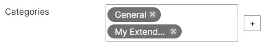
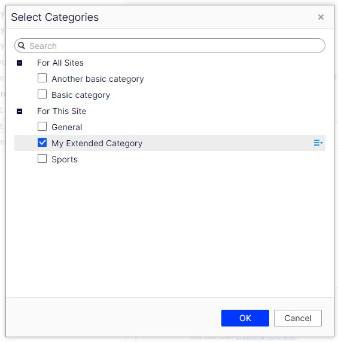
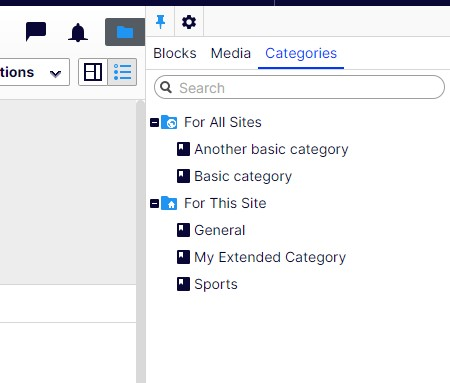
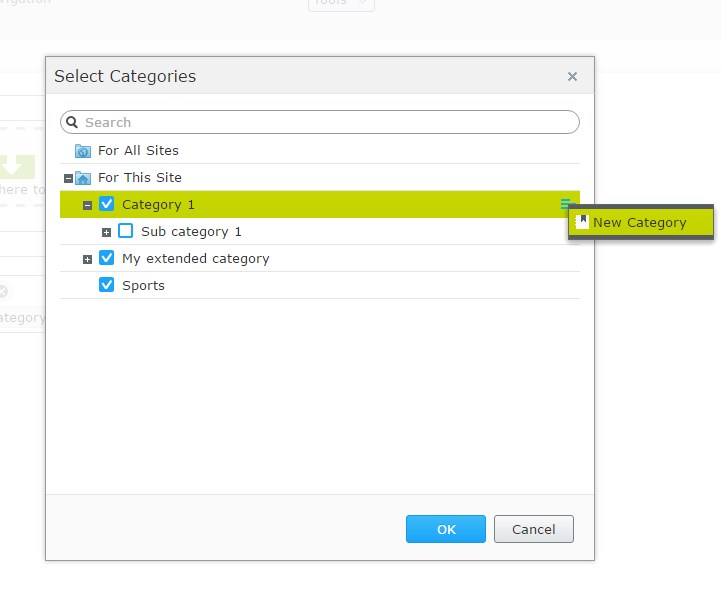
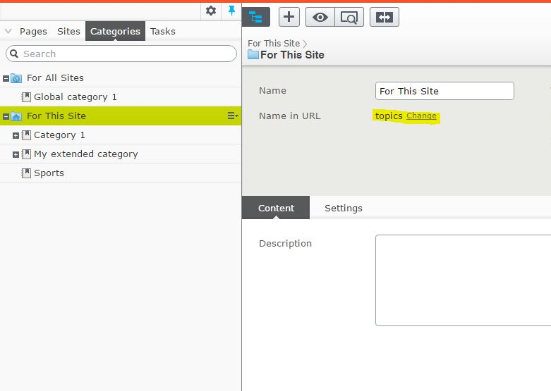
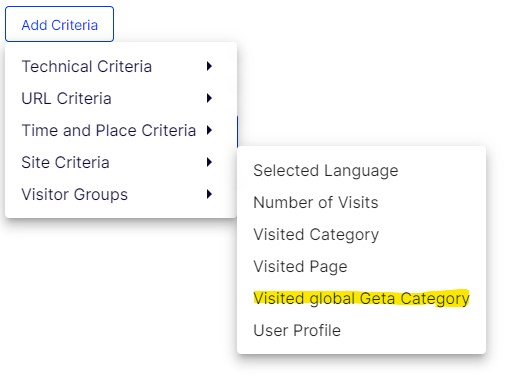

# Geta Optimizely Categories

[](https://sonarcloud.io/summary/new_code?id=Geta_geta-optimizely-categories)
[](https://docs.microsoft.com/en-us/dotnet/)
[](http://world.episerver.com/cms/)

## Description

An alternative to Optimizely's default category functionality, where categories are instead stored as localizable IContent.

## Features

* Localization (no more language XML files)
* More user friendly edit UI
* Access rights support (some editors should perhaps have limited category access)
* Shared and site specific categories in multisite solutions
* Partial routing of category URL segments
  
## How to get started?

Install NuGet package from Episerver NuGet Feed:

```
dotnet add package Geta.Optimizely.Categories
```

Register the module in Startup.cs using the following service extension

```csharp
services.AddGetaCategories();
```

Then, call the following in the `Configure` method:

```csharp
app.UseGetaCategories();
```

Start by creating a category content type that inherits from CategoryData. You can have multiple if you need. Note that CategoryData is included in the package, there is no need to create your own.

```csharp
[ContentType]
public class BasicCategory : CategoryData
{
}

[ContentType]
public class ExtendedCategory : BasicCategory
{
	[CultureSpecific]
	public virtual XhtmlString MainBody { get; set; }
}
```

Implement ICategorizableContent on your content type class to categorize your content.

```csharp
public class MyPageType : PageData, ICategorizableContent
{
  [Categories]
  public virtual IList<ContentReference> Categories { get; set; }
}
```
	
Above property will look familiar if you have used standard Optimizely categories before.




### Edit categories

Instead of going to admin mode to manage categories, you now do it in edit mode, under the "Categories" tab in the main navigation component to the left. You work with them like normal pages, and it's possible to translate them. You can create categories that are shared between multiple sites or you can create site specific categories.



## Upgrading to Optimizely CMS 13

This version targets .NET 10 and Optimizely CMS 13. Besides the framework upgrade (which requires retargeting and recompiling your solution), there is one behavioural breaking change to be aware of.

### `[AllowedTypes(typeof(CategoryData))]` no longer renders the category picker

On Optimizely CMS 12 you could skip the `[Categories]` attribute and apply `[AllowedTypes(typeof(CategoryData))]` to an `IList<ContentReference>` / `ContentReference` property to reuse the native content reference editor for categories.

On Optimizely CMS 13 the native content reference picker no longer resolves the base `CategoryData` type to its concrete category content types, so such a property opens an **empty picker** ("No Contents").

Switch the property to the package's own editor (the `[Categories]` attribute or a `CategoryUIHint`), which is unaffected:

```csharp
// Before (CMS 12) — no longer works on CMS 13
[AllowedTypes(typeof(CategoryData))]
public virtual IList<ContentReference> Categories { get; set; }

// After (CMS 13) — use one of these
[Categories]
public virtual IList<ContentReference> Categories { get; set; }

[UIHint(CategoryUIHint.Categories)]
public virtual IList<ContentReference> Categories { get; set; }
```

For a single category, use `[UIHint(CategoryUIHint.Category)]` on a `ContentReference` (unchanged).

This is a **source-only** change — stored category references are not affected and no data migration is required.

## Configuration

- CategorySeparator - defaults to **"__"**
  - i.e. "/articles/entertainment__sports/"
  - "/" also works: "/articles/entertainment/sports/"
- DisableCategoryAsLinkableType - defaults to **false**
  - Allows you to disable linking to categories in the 'Create link' modal window in the CMS (e.g. in TinyMCE or on a LinkItem)
- HideDisallowedRootCategories - defaults to **false**
  - Possibility to hide root categories based on [AllowedTypes] setting.
- ShowDefaultCategoryProperty - default to **false**
  - Allows you to show the default Episerver category property
- UseUrlPathForCategoryRetrieval - default to **false**
  - Enables retrieval of categories that match the exact URL path instead of searching for a URL segment.
- EditorAuthenticationSchemes - defaults to **empty**
  - Comma-separated authentication scheme(s) used to authorize the package's editor endpoints (`Create`, `CreatableTypes`, `Selectable` and `Children`). Leave empty to use the application's default authenticate/challenge scheme. Set this when there is no global default scheme for the app-root path - e.g. under **OptimizelyIdentity** - to the CMS editor cookie scheme(s).
  - If these endpoints can't authenticate, the picker still works but degrades: every category is selectable (no `IsSelectable` / `[AllowedTypes]` check), "Create category" fails, and the tree is listed as CMS lists it - by name, ignoring `SortIndex`, and only the first categories of a level larger than CMS's content-tree cap.

You can configure categories in Startup.cs. Below is an example where we change the category seperator:

```csharp
services.AddCategories(o =>
{
	o.CategorySeparator = "---";
});
```

In addition, the configuration can be read from the `appsettings.json`:

```
"Geta": {
    "Categories": {
      "CategorySeparator":  "__",
      "DisableCategoryAsLinkableType": false,
      "HideDisallowedRootCategories": false,
      "ShowDefaultCategoryProperty": false,
      "UseUrlPathForCategoryRetrieval": false,
      "EditorAuthenticationSchemes": ""
    }
}
```

The configuration from the `appsettings.json` will override any configuration set in Startup.cs.

### Translating the category picker

The category picker is shown in the editor's UI language. English, Swedish, Norwegian and Finnish are included; other UI languages get the English texts. The texts are under `/getacategories/editor` in the package's [lang file](src/Geta.Optimizely.Categories/lang/geta.epicategories.xml), so a site can add a language, or change a text, with the same keys in its own lang files.

### ICategorizableContent interface

There is a context menu in the selector where you quickly can create and auto publish a new category and automatically get back to the selector with the new category selected:



If you prefer a `UIHint` over the `[Categories]` attribute, use `CategoryUIHint.Categories` for a multi-select list:

```csharp
[UIHint(CategoryUIHint.Categories)]
public virtual IList<ContentReference> Categories { get; set; }
```

> **Note:** On Optimizely CMS 12 you could instead apply `[AllowedTypes(typeof(CategoryData))]` and reuse the native content reference editor. This is **no longer supported on Optimizely CMS 13** — see [Upgrading to Optimizely CMS 13](#upgrading-to-optimizely-cms-13).

If you want a single category on your content type just add a ContentReference property:

```csharp
[UIHint(CategoryUIHint.Category)]
public virtual ContentReference MainCategory { get; set; }
```

### ICategoryContentLoader interface

There is an implementation of ICategoryContentLoader that you can use to load categories:

```csharp
public interface ICategoryContentLoader
{
    T Get<T>(ContentReference categoryLink) where T : CategoryData;
    IEnumerable<T> GetChildren<T>(ContentReference parentCategoryLink) where T : CategoryData;
    //... + overloads
    T GetFirstBySegment<T>(string urlSegment) where T : CategoryData;
    //... + overloads
    IEnumerable<T> GetGlobalCategories<T>() where T : CategoryData;
    //... + overloads
    IEnumerable<T> GetSiteCategories<T>() where T : CategoryData;
    //... + overloads
    bool TryGet<T>(ContentReference categoryLink, out T category) where T : CategoryData;
    //... + overloads
    IEnumerable<T> GetCategoriesBySegment<T>(string urlSegment) where T : CategoryData;
    //... + overloads
    T GetCategoryByPath<T>(string path) where T : CategoryData;
}
```

### IContentInCategoryLocator interface

You can use IContentInCategoryLocator to find content in certain categories:

```csharp
public interface IContentInCategoryLocator
{
    IEnumerable<T> GetChildren<T>(ContentReference contentLink, IEnumerable<ContentReference> categories) where T : ICategorizableContent, IContentData;
    //... + overloads
    IEnumerable<T> GetDescendents<T>(ContentReference contentLink, IEnumerable<ContentReference> categories, CultureInfo culture) where T : ICategorizableContent, IContentData;
    //... + overloads
    IEnumerable<T> GetReferencesToCategories<T>(IEnumerable<ContentReference> categories) where T : ICategorizableContent, IContentData;
    //... + overloads
}
```

## Routing

Two routes are mapped during initialization. One for site categories and one for global categories. This means you can create templates for your category content types. They are routed in a similar way as normal pages. You can set the root segment on the "For This Site" and "For All Sites" category nodes in the Categories tree.



As illustrated in the given example, if the UseUrlPathForCategoryRetrieval is enabled (set to true), navigating to the URL "/topics/sports/" directs you to the site's "Sports" category. In a similar manner, accessing "/global-topics/global-category-1" takes you to the "Global category 1". On the other hand, when UseUrlPathForCategoryRetrieval is disabled (set to false), the URL "/topics/sports/" will retrieve all categories associated with the segment "sports". Likewise, the URL "/global-topics/global-category-1" will fetch all categories, both global and site-specific, linked with the segment "global-category-1"

### ICategoryRoutableContent interface

Implement this on your content type:

```csharp
public class ArticleListPage: PageData, ICategoryRoutableContent 
{
}
```

  It will be possible to route category URL segments with the help of a partial router shipped in this package. Let's say you have an article list page with the URL "/articles/" on your site. If you have a category with the url segment of "sports", you can add it to the end of your list page URL, "/articles/sports/", and the category data will be added to the route values with the key "currentCategory". Your controller action method could look something like this:

```csharp
public ActionResult Index(ArticleListPage currentPage, IList<CategoryData> currentCategories)
{
}
```

You can also have multiple category URL segments separated with the configured category separator: /articles/entertainment__sports/, currentCategories will now contain both "Sports" and "Entertainment". A URL segment after the categories, such as an action (/articles/entertainment__sports/feed/), is left to route as usual.

Every action that should answer a category URL needs the `IList<CategoryData> currentCategories` parameter, even if it doesn't use it: CMS only picks an action that has a parameter for each route value. With `Feed(ArticleListPage currentPage)` alone, /articles/entertainment__sports/feed/ returns 404.

With `UseUrlPathForCategoryRetrieval`, each category is written as its full path from the categories root, including the root's own URL segment: /articles/categories/sports/football/. The URL helpers below write category paths this way too. Categories are separated with the category separator, as above; with `/` as the separator, a URL holds one category path. Every category in the URL has to exist: unlike URL segments, an unknown category path isn't skipped.

### Sort order

Categories are listed by their **Sort index** (`SortIndex`, lower first), then by name, in the picker and by `ICategoryContentLoader.GetChildren`, `GetGlobalCategories` and `GetSiteCategories`. The picker's search lists exact matches first, then names that start with the search, then the rest, each in that order. Every category starts at 0, so without sort indexes the order stays alphabetical. Names are compared in the language the categories are listed in.

To list a level in the same order elsewhere, for example children loaded through `IContentLoader`, use `InCategoryOrder()`:

```csharp
using Geta.Optimizely.Categories.Extensions;

var topics = _contentLoader.GetChildren<CategoryData>(topicsLink).InCategoryOrder();
```

`SortIndex` places a category among its siblings, so for categories from several levels, such as a page's selected categories, `InCategoryOrder()` compares places under different parents.

### More than one categories root

The package keeps one categories root in the global assets folder and one in each site's assets folder. If an import adds another root next to one of them, the categories under every root are still used: the picker lists them (the root in use's first), its search finds them, category routing resolves them, and `GetGlobalCategories`/`GetSiteCategories` return them. New categories are created under the root in use. That's the root that holds categories rather than an empty one; otherwise the first root CMS lists (the one whose name sorts first), and of roots with the same name, the oldest. Moving them under the root in use is optional. A root imported under the root in use is listed in the picker as a group that can't be picked, with its categories under it.

	
There are a couple of UrlHelper and UrlResolver extension methods included to get content URL with category segment added:

```csharp
	@Url.CategoryRoutedContentUrl(/*ContentReference*/ contentLink, /*ContentReference*/ categoryContentLink) // Single category
	@Url.CategoryRoutedContentUrl(/*ContentReference*/ contentLink, /*IEnumerable<ContentReference>*/ categoryContentLinks) // Multiple categories

	@UrlResolver.Current.GetCategoryRoutedUrl(/*ContentReference*/ contentLink, /*ContentReference*/ categoryContentLink) // Single category
	@UrlResolver.Current.GetCategoryRoutedUrl(/*ContentReference*/ contentLink, /*IEnumerable<ContentReference>*/ categoryContentLinks) // Multiple categories
```

### Visitorgroup



You can use Geta Categories as visitor group criteria. Meaning that a user has to visit a page with the configured category a certain amount of times to match the criteria.

## Sandbox App
Sandbox application is testing poligon for package new features and bug fixes.

CMS username: admin@example.com
Password: Episerver123!

## Breaking changes from Geta.EpiCategories

- The partial router for `ICategoryRoutableContent` only supports `IList<CategoryData>`
- `IEnumerableExtensions`: `MemberOf` `MemberAny` `MemberAll` have been moved to [Geta.Optimizely.Extensions v2.1.0](https://github.com/Geta/geta-optimizely-extensions/releases/tag/v2.1.0)

## Package maintainer

https://github.com/MattisOlsson

https://github.com/brianweet
